# Social Stream Ninja creator media pack

Logos, graphics, and a short promo for your videos, streams, and social posts. Link viewers to **[socialstream.ninja](https://socialstream.ninja/)**.

**Quick start:** grab the [15-second promo](video/social-stream-ninja-15s-1080p.mp4), choose a [transparent logo](#logos), or copy a script from [AD-COPY.txt](AD-COPY.txt). For OBS setup and editing tips, see [START-HERE.txt](START-HERE.txt).

Click a preview to open its image. On GitHub, use **Download raw file** on the file page to save the original. These assets are excluded from the repository's source ZIP downloads; download the files individually here.

## Logos

Use transparent PNGs over your own footage or backgrounds. Keep their proportions when resizing.

| Preview | What it is | Files |
| --- | --- | --- |
|  | **Transparent mascot** · 1254 × 1254. The ninja without lettering or a background. | [PNG](logos/ninja-transparent.png) |
| [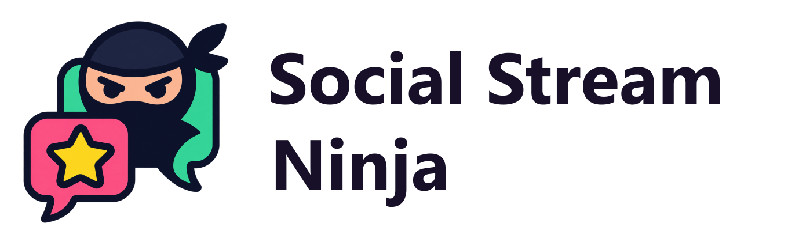](logos/wordmark-dark-text.png) | **Horizontal logo** · 1360 × 420. Choose dark lettering for light backgrounds or white lettering for dark footage. Both have transparent backgrounds. | PNG: [dark text](logos/wordmark-dark-text.png) · [white text](logos/wordmark-light-text.png) Editable SVG: [dark text](editable/wordmark-dark-text.svg) · [white text](editable/wordmark-light-text.svg) |

## Video and full-screen cards

The **[15-second promo video](video/social-stream-ninja-15s-1080p.mp4)** moves through the promo, feature, and end cards below. It is a silent 1920 × 1080, 30 fps H.264 MP4. Add it as an OBS Media Source or drop it into your video editor. The [15-second voiceover script](AD-COPY.txt) follows its timing; add your own voice or music if desired.

| Preview | What it is | Files |
| --- | --- | --- |
| [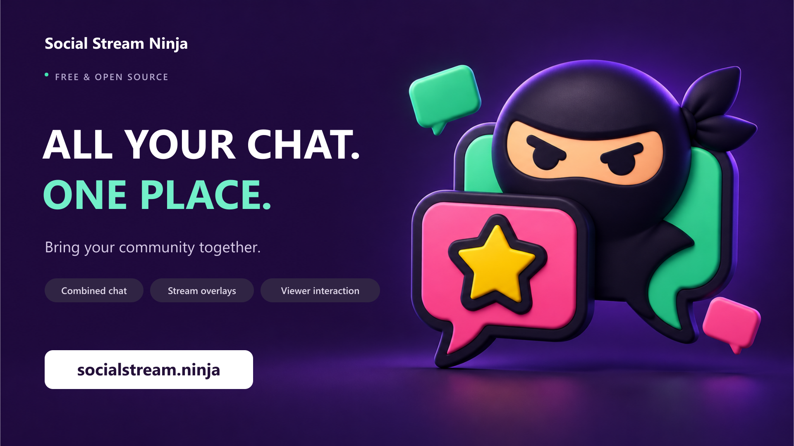](graphics/promo-1920x1080.png) | **Main promo card.** A full-screen introduction with the tagline, key features, and website. | PNG: [1080p](graphics/promo-1920x1080.png) · [4K](graphics/promo-3840x2160.png) [Editable SVG](editable/promo-1920x1080.svg) |
| [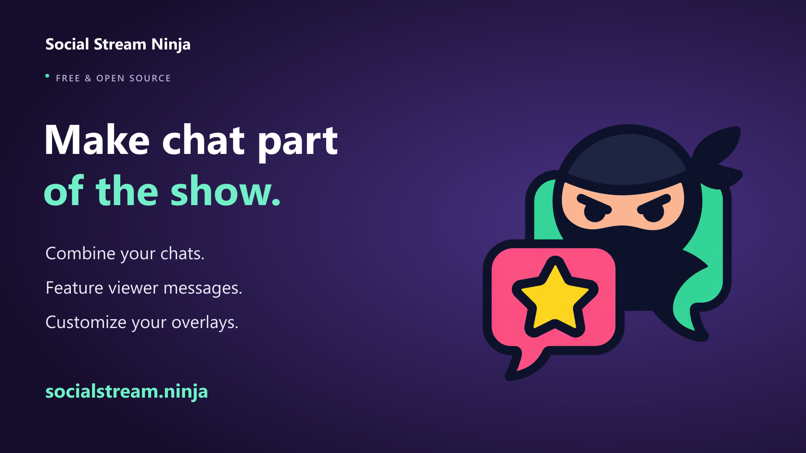](graphics/features-1920x1080.png) | **Feature card** · 1920 × 1080. A quick explanation of what Social Stream Ninja does. | [PNG](graphics/features-1920x1080.png) · [Editable SVG](editable/features-1920x1080.svg) |
| [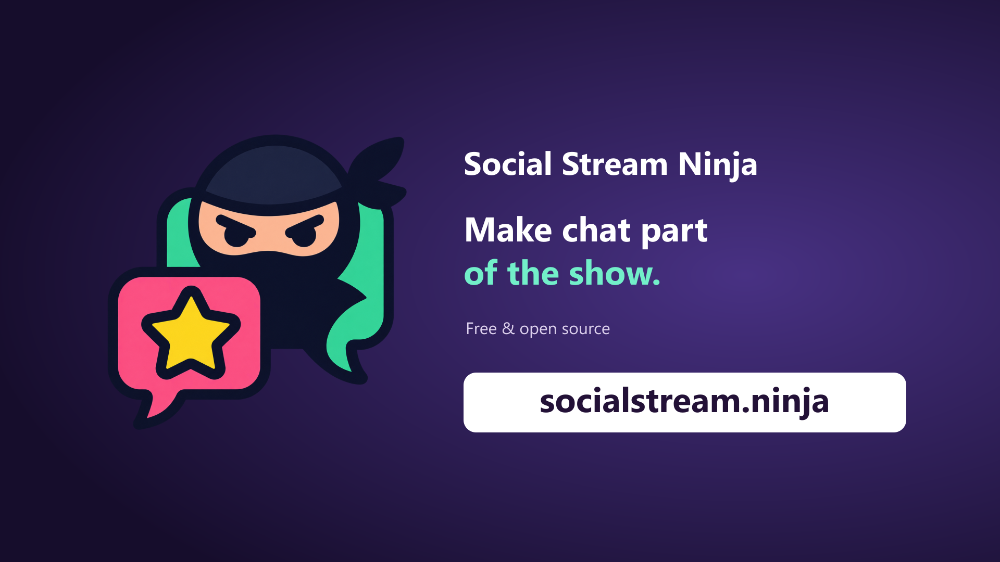](graphics/end-card-1920x1080.png) | **End card.** Finish a video or ad with the name and a large website address. | PNG: [1080p](graphics/end-card-1920x1080.png) · [4K](graphics/end-card-3840x2160.png) [Editable SVG](editable/end-card-1920x1080.svg) |

1080p cards are 1920 × 1080; 4K cards are 3840 × 2160. Both are 16:9.

## Social posts and stream graphics

| Preview | What it is | Files |
| --- | --- | --- |
| [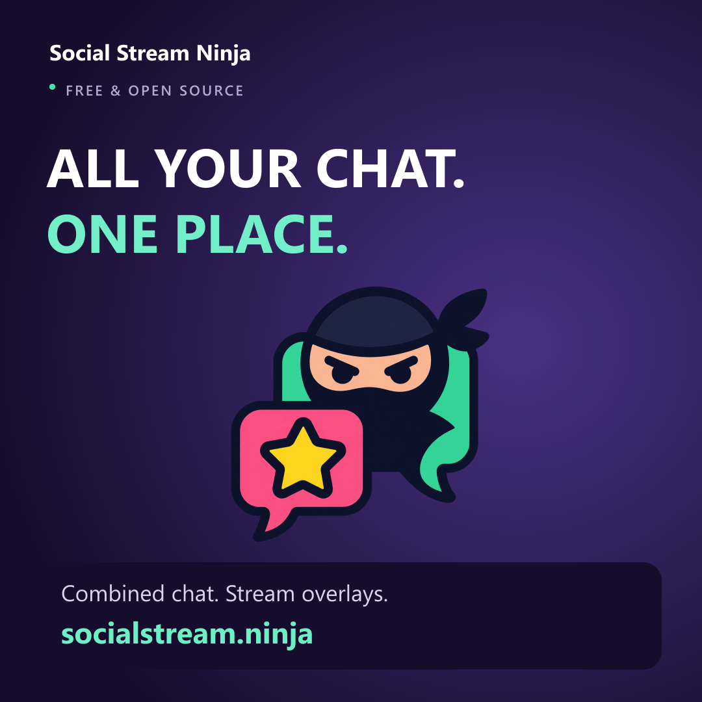](graphics/social-square-1080x1080.png) | **Square post** · 1080 × 1080. A ready-made graphic for social feeds. | [PNG](graphics/social-square-1080x1080.png) · [Editable SVG](editable/social-square-1080x1080.svg) |
| [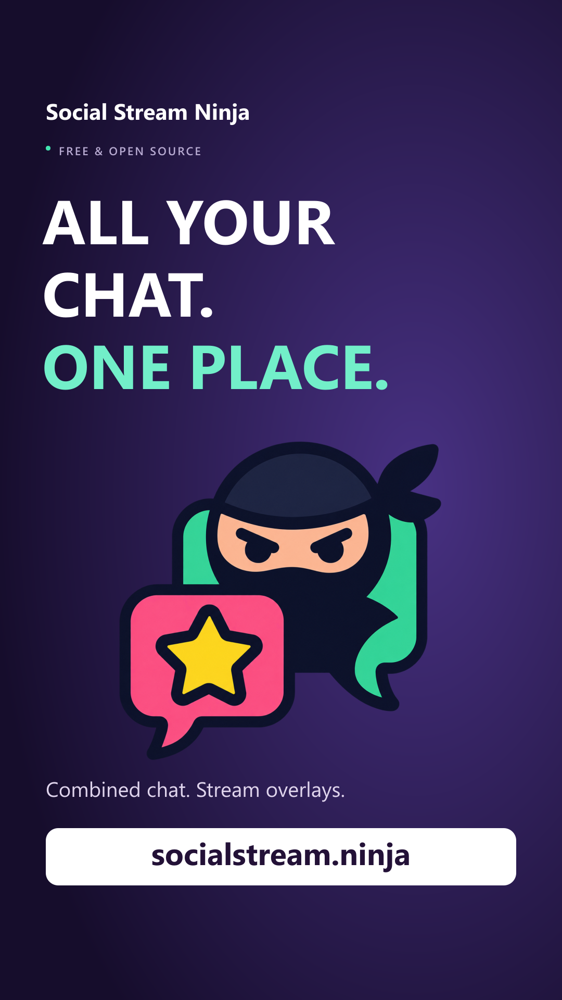](graphics/social-vertical-1080x1920.png) | **Vertical post** · 1080 × 1920. A 9:16 card for Stories, Shorts, or vertical video. | [PNG](graphics/social-vertical-1080x1920.png) · [Editable SVG](editable/social-vertical-1080x1920.svg) |
|  | **Lower third** · 1200 × 320. Place this banner over footage as an OBS Image source or in your editor. The area around the banner is transparent. | [PNG](graphics/lower-third-transparent-1200x320.png) · [Editable SVG](editable/lower-third-transparent-1200x320.svg) |
| [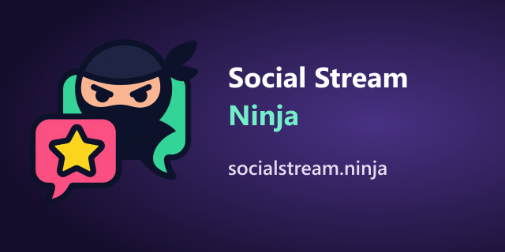](graphics/channel-panel-640x320.png) | **Channel panel** · 640 × 320. Add to your channel page and set its link to https://socialstream.ninja/. | [PNG](graphics/channel-panel-640x320.png) · [Editable SVG](editable/channel-panel-640x320.svg) |

## Artwork and QR code

| Preview | What it is | Files |
| --- | --- | --- |
| [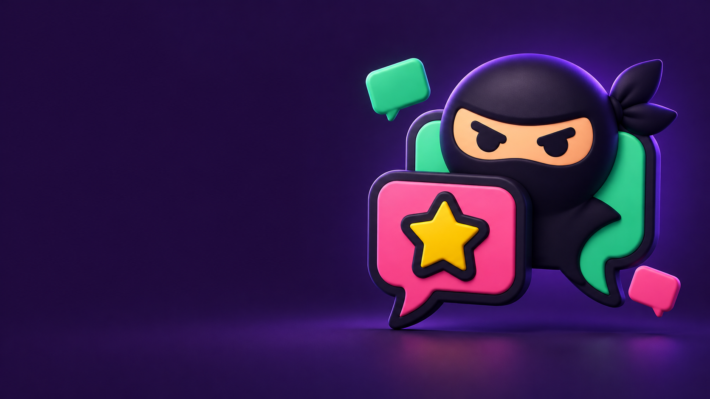](graphics/campaign-background.png) | **Campaign background** · 1672 × 941. Artwork without text, with space for your own headline on the left. | [PNG](graphics/campaign-background.png) |
| [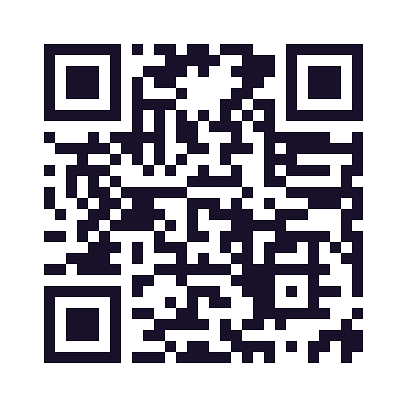](graphics/website-qr.png) | **Website QR code.** Opens https://socialstream.ninja/. Keep the white margin and test scanning it at its final size on screen. | [PNG](graphics/website-qr.png) · [SVG](editable/website-qr.svg) |
| [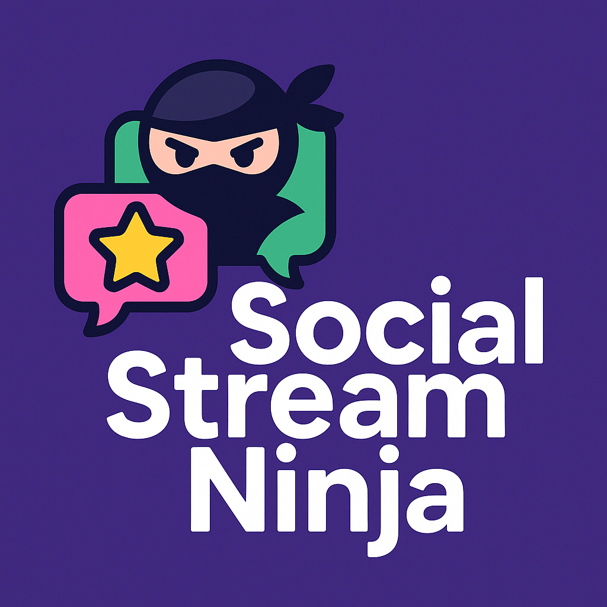](originals/social-stream-ninja-original.png) | **Original square logo** · 1024 × 1024. The existing project artwork, including its purple background and lettering. | [PNG](originals/social-stream-ninja-original.png) |
| [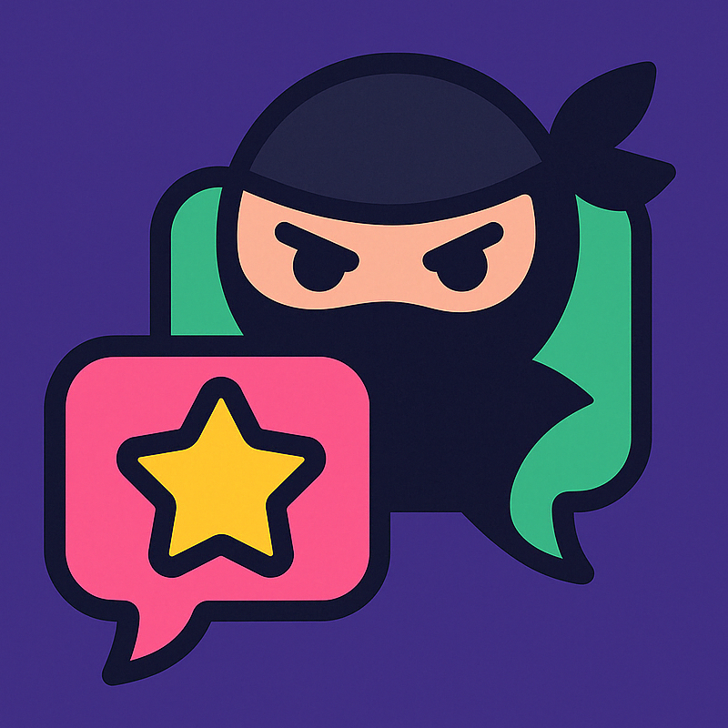](originals/ninja-original.png) | **Original mascot** · 800 × 800. The existing mascot artwork with its purple background. | [PNG](originals/ninja-original.png) |

## Copy, setup, and editing

| Resource | What you get |
| --- | --- |
| [Ad copy and voiceover scripts](AD-COPY.txt) | Approximate 10-, 15-, and 30-second reads, post and video-description copy, and channel-panel text. |
| [Setup and brand guide](START-HERE.txt) | OBS instructions, format choices, colors, and logo usage tips. |
| [Visual overview](PREVIEW.png) | A single image showing six of the main designs, handy for choosing or sharing a style. |
| [Editable layouts](editable/) | SVG versions of the graphics and horizontal logos, plus the QR code. Individual links appear beside each preview above. |

The SVG layouts contain editable text and embedded raster artwork. They use Segoe UI with Arial as a fallback; fonts are not included. Check text placement after editing, or use the PNGs for the exact supplied appearance.
