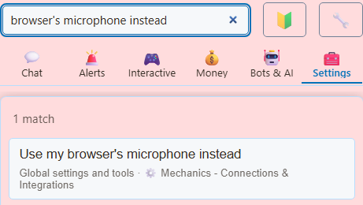
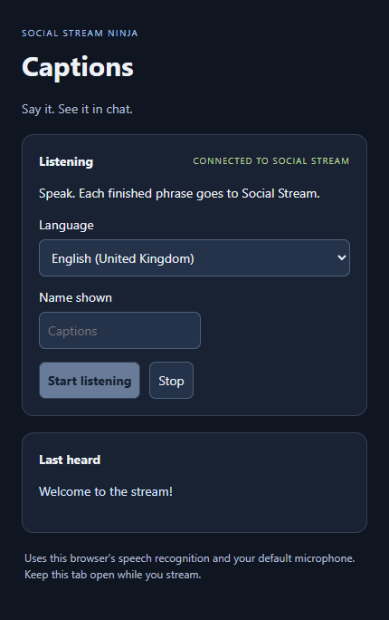
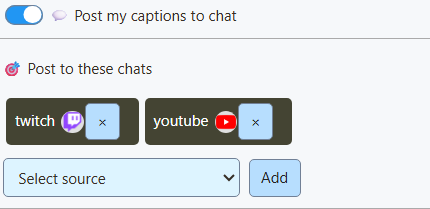

# Speak to chat with SSN's built-in mic

**Start in the Social Stream Ninja app or browser extension.** SSN opens a second page called **Captions** in your browser. Keep both open while you stream. [Get Social Stream Ninja](https://socialstream.ninja/docs/download.html)

## 1. 🎙️ Open the mic

In the **desktop app**, turn on **Enable Beta Mode** above **Added Sources**. If you use the **beta browser extension**, click its SSN toolbar icon.

Switch SSN on. In its **Search settings** box, type **browser's microphone instead**. Select the result, then click **Use my browser's microphone instead** to open your session's **Captions** page in Chrome or Edge.

If the desktop app shows **Copy this page's link**, paste that link into your browser.

## 2. Start listening

On the **Captions** browser tab, choose your language. Below **Name shown**, click **Start listening** and allow microphone access.

Say a short sentence, then pause. The **Last heard** box directly below the buttons shows your words.

**Want to see the same words in the dock?** Back in SSN, select the **Chat** tab and open the link under **Main chat overlay & control dock**.

## 3. 💬 Post to chat (optional)

In SSN, open **Settings** and search for **Post my captions to chat**. Turn it on, choose a connected chat from **Select source**, and click **Add**. Speak again to send your next sentence there.

**Want fewer posts?** Increase **Seconds between posts**. Captions still appear in the dock as soon as you finish speaking.

**Already using Caption.Ninja as your mic?** [Follow the Caption.Ninja setup guide](https://github.com/steveseguin/captionninja/blob/master/social-stream.md).
