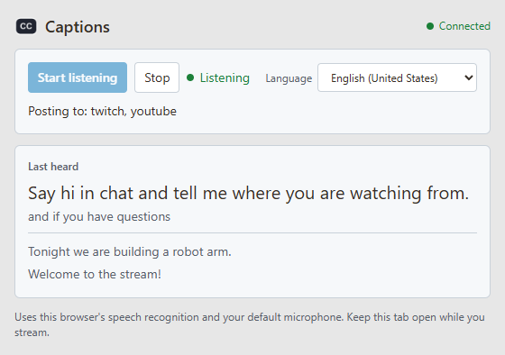
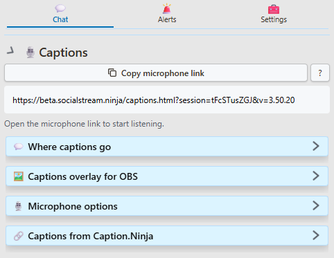
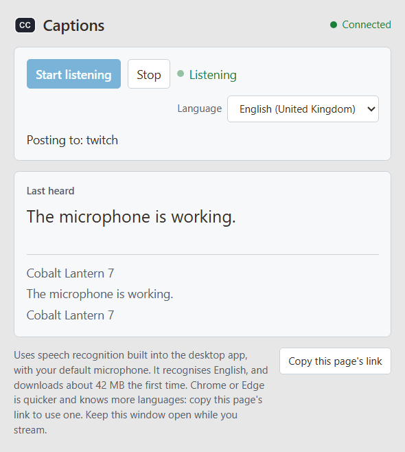
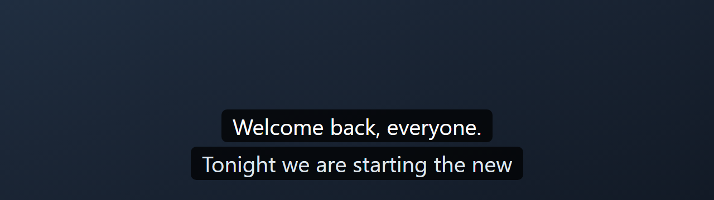
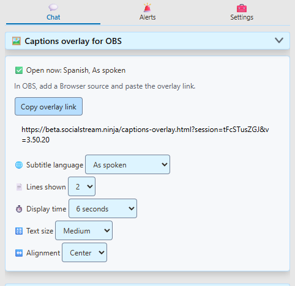
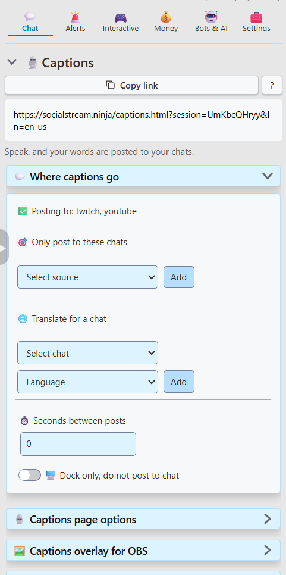
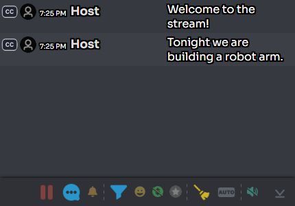
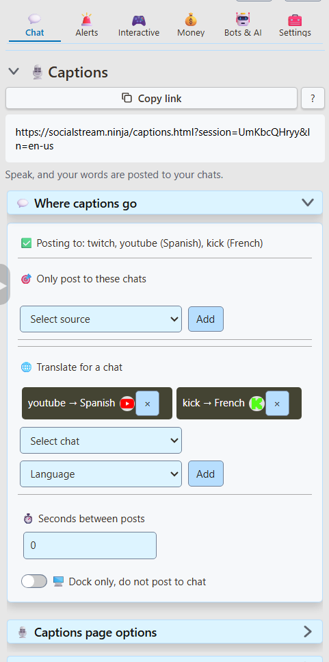

# Speak to chat and show captions in OBS

Use your microphone to post what you say to your connected chats or keep it in your SSN dock. With either choice, you can [show your words as subtitles in OBS](#obs).

You need [Social Stream Ninja](https://socialstream.ninja/docs/download.html) and a microphone. Captions is in beta: in the **desktop app**, turn on **Enable Beta Mode** above **Added Sources** to see it.

## 1. Open Captions

1. Open Social Stream Ninja, switch it on, and open your chats as you normally do.
2. Select the **Chat** tab and scroll down to **Captions**.
3. Click the link under the **Captions** title.

## 2. Start listening

The first time, the page asks where your captions should go. Choose **Post to my chats** to send them from your account, or **My dock only** to keep them out of chat. Both choices work with OBS.

After that, the line under the buttons says where your words will go, for example **Posting to twitch, youtube**. Check it before you start.

### In Chrome or Edge

1. Choose your **Spoken language**.
2. Click **Start listening** and allow microphone access.
3. Say a short sentence, then pause. Look under **Last heard** on this page, then check the chat or dock you chose.

### In the desktop app

The page opens in its own window and listens with speech recognition built into the app.

1. Click **Start listening** and say a short sentence, then pause.
2. The first time, wait while it downloads about 42 MB. After that it works offline.

The desktop app recognises **English only**, a second or two after you pause. For another language, or quicker captions, click **Copy microphone link** and open it in Chrome or Edge.

Keep the Captions page open while you stream.

## Show captions on your stream in OBS

1. In the SSN **Chat** tab, open **Captions → Captions overlay for OBS**. Leave **Subtitle language** on **As spoken** or choose a translation. Click **Copy overlay link** inside that group.
2. In OBS, choose your scene. Under **Sources**, click **+ → Browser → Create new → OK**.
3. Paste the link into **URL**, set **Width** and **Height** to your canvas size, and click **OK**.
4. With the Captions page listening, say a sentence. Watch the bottom of the OBS preview. Chrome and Edge show words as you speak. Translations and the desktop microphone show each sentence after you pause.

To change text size, alignment, line count or how long lines stay, use **Captions overlay for OBS** in SSN. Copy the updated link into the OBS source. For two languages, add a second Browser source with its own language and link.

## 3. Choose where captions go (optional)

In SSN, under **Captions**, open **Where captions go**. The first line shows the chats in use right now.

- **Every connected chat** is the default. There is nothing to set.
- **Only some chats:** under **Only post to these chats**, choose a chat from **Select source** and click **Add**. Repeat for each one.
- **Fewer posts:** increase **Seconds between posts**. What you said in between goes out as one post.
- **Not in chat at all:** turn on **Dock only, do not post to chat**. Your captions then appear straight in your dock and overlays, marked **CC**, and nothing is posted.

Dock-only captions use the first name under **Identify the hosts' name** in SSN's settings.

## 4. 🌐 Translate for a chat (optional)

You can post in another language to one chat while the others get your words as spoken.

1. In SSN, under **Captions**, open **Where captions go**.
2. Under **Translate for a chat or dock**, choose the chat, choose the language, and click **Add**. A tag appears, for example **youtube → Spanish**.

- The Captions page then shows it, for example **Posting to twitch, youtube (Spanish)**.
- A chat with a language gets that language or nothing. If a translation cannot be made in time, that one post is skipped and counted as **not sent**.
- The first time you use a language it is prepared, which can take a few seconds. The page says **Preparing Spanish** and how many captions were skipped meanwhile. Those are not posted later.
- A tag only changes the language of a chat already in use. To translate what your dock shows, turn on **Dock only** and add a tag for **SSN dock**.
- It uses the translator chosen under **Bots & AI → Auto Translate**: the free built-in one, or your AI provider.

## If something is not right

| You see | Do this |
| --- | --- |
| "No chat connected for posting" | Open your chats in SSN, the same ones it shows messages from. Or switch on **Dock only**. |
| The same caption several times in your dock | Each chat sends your post back. In SSN's **Settings**, under **Message - Visibility**, turn on **Hide duplicates; show your first reply only**. SSN has to know which messages are yours: add your account names under **Identify the hosts' name** (Twitch is recognised by itself). |
| "Posting to" lists a page you did not expect | Under **Where captions go**, pick only the chats you want. WhatsApp, Telegram, Discord, Slack and meeting pages are never used unless you pick them. |
| **Not connected** on the Captions page | Switch SSN on and keep it open. |
| The page asks for a **Session ID** | In SSN, click **Copy ID** at the top of the **Chat** tab and paste it in. If your session has a password, paste your dock link instead: it brings the password with it. |
| "Speech recognition is unavailable here" | Click **Copy microphone link** and open it in Chrome or Edge. |
| "The desktop app recognises English only" | Choose an English language, or copy the page's link into Chrome or Edge. |
| "Allow microphone access" | Allow the microphone for the page, then click **Start listening** again. |
| "Unavailable: Spanish" | The free translator does not cover that language from the one you speak. Choose your AI provider under **Bots & AI → Auto Translate**, or remove the tag. |
| The overlay in OBS stays empty | Under **Captions overlay for OBS**, read the first line. **No overlay connected** means OBS has not loaded your link: paste it into the Browser source again. If it says **Open now**, check that the Captions page is listening and that you have chosen where your captions go. |
| The overlay shows whole sentences, not the words as you speak | A translated overlay and the desktop app's own Captions window both work that way. Set **Subtitle language** to **As spoken** and open the Captions page in Chrome or Edge. |

## Other setups

**Always the same language?** Under **Captions**, open **Microphone options**. Your choice becomes part of the link, and the page can start listening as soon as it opens.

**Already using Caption.Ninja as your mic?** Your Caption.Ninja room can feed the same OBS overlay. [Connect Caption.Ninja to SSN](https://github.com/steveseguin/captionninja/blob/master/social-stream.md).
